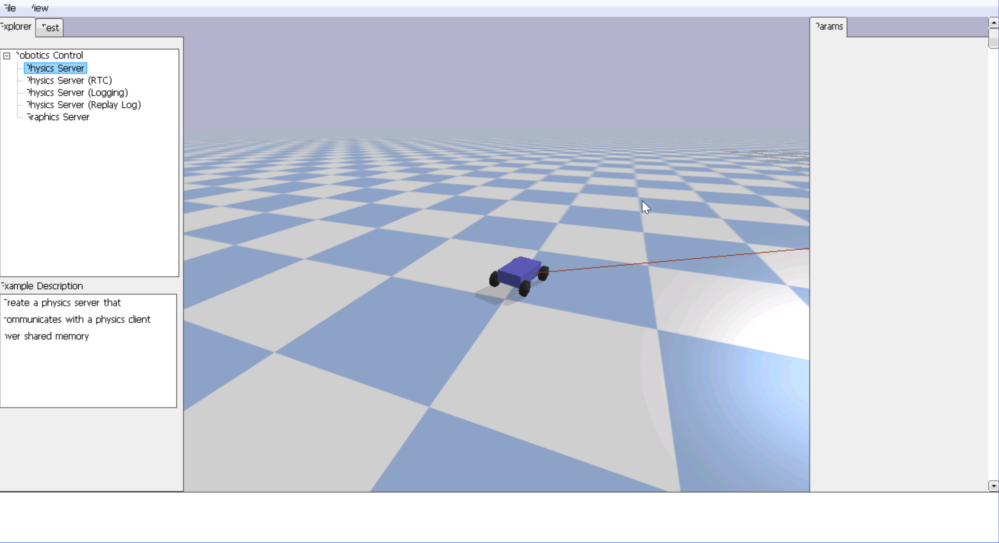

# MY_DRL
2023.10

一个深度强化学习实验项目，使用 **Python、PyTorch、Gym 和 PyBullet**，包含 PPO 实现、自定义仿真环境，以及早期强化学习练习。

项目保留原始实验代码、模型权重和仿真资源，作为学习与探索过程的记录。

## 演示



## 项目内容

- **Actor–Critic 网络与 PPO：**`PPO_trainer.py` 包含离散和连续动作相关实现。
- **遥控小车环境：**`Pybullet_envs.py` 中的 `RC_ENV` 使用 PyBullet 模拟小车驶向目标位置。
- **其他学习代码：**多个 `DRL_test*.py`、DeepMimic 相关环境、图形与仿真实验。

## 文件说明

| 文件 / 目录 | 内容 |
| --- | --- |
| `main.py` | 当前小车演示入口，加载已有模型并调用 `test_play()` |
| `PPO_trainer.py` | Actor–Critic 网络、PPO 训练与测试代码 |
| `Pybullet_envs.py` | 小车、环境与相机逻辑 |
| `work_on_pybullet.py` | PyBullet 模型、关节和控制实验 |
| `deep_mimic_env.py` | DeepMimic 相关环境实验 |
| `DRL-test.py`、`DRL_test*.py` | 不同阶段的强化学习练习 |
| `PPO参考.py` | 原项目中的 PPO 参考代码 |
| `RC_car_nn(25_15).pth` | 已有小车模型权重 |
| `RC_car.urdf`、`slope.urdf`、`plane/` | 小车、斜坡、地面模型及资源 |
| `函数拟合专用.csv`、`图形测试.py` | 其他实验文件 |
| `showcase.gif` | 项目演示动画 |

## 依赖与运行

根据源码导入，主要依赖为：

- `torch`
- `numpy`
- `gym`
- `pybullet`

部分实验脚本还使用 `matplotlib`、`keyboard`、`plotly` 和 `setuptools` 中的 `pkg_resources`。

原项目没有保存依赖版本锁定文件。这里列出的是源码依赖，不代表已经验证最新版本之间的兼容性。

安装匹配的依赖后，从项目根目录运行小车演示入口：

```powershell
python main.py
```

当前 `main.py` 加载 `RC_car_nn(25_15).pth` 并调用 `trainer.test_play()`；训练调用保留在同一文件的注释中。

模型和 URDF 使用相对路径，运行时应保持项目根目录为工作目录。PyBullet 演示使用图形窗口。

Python 缓存、虚拟环境和 IDE 本机配置通过 `.gitignore` 排除；原有 `.pth` 权重与 `plane/plane100.obj` 网格均保留在仓库中。

知道我当年写这个的时候绝望地发现我没有使用并行计算。结果导致计算效率超级低下，稍微复杂点的模型就根本训不下去了，这给了我惨痛的教训。
